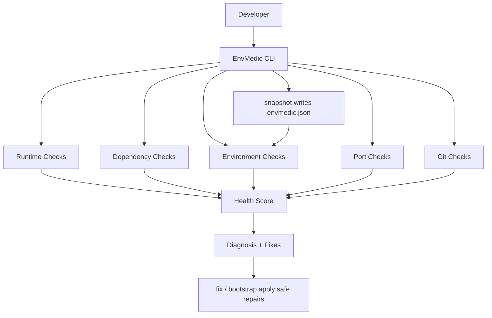

<div align="center">


# EnvMedic

> **It works on my machine. Until it doesn't.**

EnvMedic diagnoses broken development environments, catches setup issues, and takes your team from **"why isn't this working?" → "we're so back."**


```bash
npx envmedic doctor
```

</div>

---

> **Stop debugging the environment when you should be shipping the project.**
>
> EnvMedic checks your runtime, dependencies, environment variables, ports, Git state, and project configuration — locally. Nothing leaves your machine.

---

## Quick Start

Run EnvMedic directly with npx. No global installation required.

```bash
npx envmedic doctor
```

That's the whole install step. Early days (v0.1) — if the name hasn't propagated yet, clone and run from source instead:

```bash
git clone https://github.com/whyss-crypto/envmedic.git
cd envmedic
npm install
npm run doctor
```

All four commands work the same way:

```bash
npx envmedic doctor     # diagnose this project
npx envmedic fix        # apply safe fixes
npx envmedic bootstrap  # fresh-machine setup in one command
npx envmedic snapshot   # write envmedic.json for your teammates
```

> EnvMedic is in early development (v0.1.x) — Node.js/npm projects first, `doctor` output and scoring may evolve. Pin a version if your team likes stability.

---

## The Problem

```text
"It works on my machine."
        ↓
Wrong Node version
        ↓
Missing dependency
        ↓
Missing API key
        ↓
Port collision
        ↓
2 hours of debugging
        ↓
"bro what changed?"
```

Every team has this lore. It's always the environment. It's never the code. (It's the environment.)

## Meet EnvMedic

EnvMedic is a local CLI that diagnoses development-environment problems and tells you exactly **what is wrong, why it matters, and how to fix it.**

```text
$ npx envmedic doctor

checking environment...

✓ Node.js 22
✓ npm
✓ package.json
✓ git

✗ GEMINI_API_KEY missing
✗ port 3000 already occupied
△ node version mismatch

PROJECT HEALTH
68 / 100

bro...

your environment is cooked.

Run:
  envmedic fix
```

```text
$ envmedic fix

finding safe fixes...

✓ generated .env.example
✓ resolved port conflict
✓ dependency check passed

PROJECT HEALTH
68 → 100

we're so back.
```

---

## Commands

### `doctor`

```bash
npx envmedic doctor
```

Scans the local project and environment for common setup problems.

- Node / runtime version (including `engines` mismatches)
- npm / package manager (npm, pnpm, yarn, bun via lockfiles)
- Dependencies (missing packages, version conflicts, lockfile drift)
- Environment variables (missing vars, incomplete `.env.example`)
- Ports (occupants, with process info and free alternatives)
- Git (repo state, branch, clean/dirty tree)
- Project configuration (framework, scripts, build readiness)

Add `--json` for machine-readable output, or check extra ports:

```bash
npx envmedic doctor --json
npx envmedic doctor --port 3000 --port 5173
```

### `fix`

```bash
npx envmedic fix
```

Applies safe project-level fixes, prints exact manual commands for everything else.

- Installs missing dependencies
- Generates `.env.example` (names only — never values)
- Creates a `.env.local` template (existing files are never overwritten)
- Suggests free ports instead of killing your processes

> EnvMedic never silently modifies sensitive system configuration. Anything risky gets an explanation and a command — not a surprise.

Preview mode included:

```bash
npx envmedic fix --dry-run
```

### `bootstrap`

```bash
npx envmedic bootstrap
```

Fresh clone → ready-to-run project. One command.

```text
clone repo
   ↓
envmedic bootstrap
   ↓
check runtime
   ↓
install dependencies
   ↓
configure project
   ↓
validate environment
   ↓
ship
```

### `snapshot`

```bash
npx envmedic snapshot
npx envmedic snapshot --force   # overwrite an existing envmedic.json
```

Writes a machine-readable `envmedic.json` describing what this project expects. Commit it — it's how the next person reproduces your environment.

```json
{
  "runtime": {
    "node": "22.x",
    "packageManager": "npm"
  },
  "commands": {
    "dev": "npm run dev",
    "build": "npm run build"
  },
  "ports": [3000],
  "env": ["GEMINI_API_KEY", "DATABASE_URL"]
}
```

---

## Features

### Runtime Checks
Catch version mismatches before they become debugging sessions. `engines.node` is actually enforced, not decorative.

### Dependency Diagnosis
Missing packages, version conflicts, lockfile drift — translated from npm word-salad into human sentences.

### Environment Variable Detection
Source-scans for `process.env.*`, diffs against `.env` / `.env.local` / `.env.example`. Names only. Values never printed. **npm said no to leaking your secrets, and so do we.**

### Port Diagnostics
Finds what's squatting on your dev port (process name + PID included) and hands you the next free one. **Port 3000 has been claimed.** 3001 hasn't.

### Git / Project Checks
Repo state, branch, dirty tree, scripts, framework detection, build readiness. The boring stuff that bites.

### Team Bootstrap
Snapshot the expected environment once. Everyone else runs one command. **Skill issue avoided.**

---

## Stop sending setup lore in the group chat.

```text
"What Node version?"
"Which env vars?"
"Why is port 3000 broken?"
"Why doesn't this work on my laptop?"
```

```text
Developer A
     ↓
envmedic snapshot
     ↓
envmedic.json
     ↓
Developer B
     ↓
envmedic bootstrap
     ↓
same environment
```

> **No lore. No guesswork. Just ship.**

---

## Architecture



One orchestrator (`core/diagnose.ts`) runs every check, scores the results, and hands a single `Diagnosis` object to all four commands. Adding a new runtime later means one new file in `checks/` — nothing else moves. Full write-up in [`docs/ARCHITECTURE.md`](docs/ARCHITECTURE.md).

## Project structure

```text
envmedic/
├── src/
│   ├── cli.ts
│   ├── commands/
│   │   ├── doctor.ts
│   │   ├── fix.ts
│   │   ├── bootstrap.ts
│   │   └── snapshot.ts
│   ├── checks/
│   │   ├── node.ts
│   │   ├── package-manager.ts
│   │   ├── dependencies.ts
│   │   ├── project.ts
│   │   ├── env.ts
│   │   ├── ports.ts
│   │   └── git.ts
│   └── core/
│       ├── diagnose.ts
│       ├── health-score.ts
│       ├── env-scan.ts
│       ├── project.ts
│       ├── semver.ts
│       └── snapshot.ts
├── demo/
│   └── broken-app/      # deliberately broken fixture (5 baked-in problems)
├── docs/
│   ├── ARCHITECTURE.md
│   └── DEMO.md
├── package.json
├── tsconfig.json
├── LICENSE
└── README.md
```

## Tech stack

```text
TypeScript
Node.js
Commander.js
Chalk
Ora
Zod
Execa
dotenv
detect-port
```

## Local-first by design

- Everything runs on your machine. There is no backend, no account, no dashboard.
- Secret **values** are never printed, never transmitted, never written into templates.
- `.env` files that already exist are never overwritten.
- Processes are never killed. System config is never touched silently.
- Anything destructive asks first or doesn't happen.

## Development

```bash
git clone https://github.com/whyss-crypto/envmedic.git
cd envmedic
npm install
npm run doctor      # diagnose this repo
npm run build       # compile to dist/
```

`npm run dev` runs the CLI from source via `tsx`. Per-command shortcuts (`fix`, `bootstrap`, `snapshot`) follow the same pattern — check `package.json`.

### Publishing

The package is publish-ready (`bin`, `files`, `engines`, ISC license all set) but **not yet published** — publishing is a deliberate human decision.

```bash
npm pack --dry-run   # verify name, version, files, size, no secrets
npm login
npm publish
```

Pre-publish checklist: name `envmedic` @ `0.1.0`, `dist/` + `README.md` + `LICENSE` only in the tarball (~35 kB), `dist/cli.js` keeps its shebang, and no `.env` / secrets anywhere near the package (`files` allowlists `dist`, `README.md`, `LICENSE` — nothing else ships).

## See it in action

A deliberately broken project lives in [`demo/broken-app`](demo/broken-app). The 2-minute script is in [`docs/DEMO.md`](docs/DEMO.md).

### Before

```text
❌ Node mismatch
❌ API key missing
❌ Port occupied
```

### After

```text
✅ environment validated
✅ safe fixes applied
✅ project ready
```

**Locked in.**

---

## FAQ

### Does EnvMedic need a database?
No. The CLI operates entirely locally.

### Does EnvMedic upload my `.env` file?
No. Variable detection only reads *names*, never values — and nothing leaves the machine. Run `doctor --json` and grep for a secret. It's not there.

### What does EnvMedic support?
Node.js / npm / React / Next.js projects (with pnpm, yarn, and bun detected via lockfiles). Python, Docker, and friends are out of v0.1 scope by design.

### Can it automatically fix everything?
No — and that's a feature. Safe project-level fixes are automated; secret values, Node version switches, and occupied ports are surfaced with exact manual commands.

### Is EnvMedic open source?
Yes — ISC licensed. See [`LICENSE`](LICENSE).

---

## Roadmap

```text
[x] Node.js environment checks
[x] Dependency diagnostics
[x] Environment-variable detection
[x] Port detection
[x] Safe auto-fix
[x] One-command bootstrap
[x] Environment snapshots

[ ] Better framework detection
[ ] Python environment support
[ ] Docker diagnostics
[ ] Team environment comparison
[ ] CI integration
```

## Contributing

```text
1. Fork the repo
2. Create a branch
3. Make your change
4. Run npm run build
5. Open a pull request
```

> Found a cursed edge case? Open an issue.

## License

ISC — see [`LICENSE`](LICENSE).

---

<div align="center">

> **Fix the environment. Ship the project.**

**EnvMedic**

*Built for developers who are done hearing "works on my machine."*

</div>
